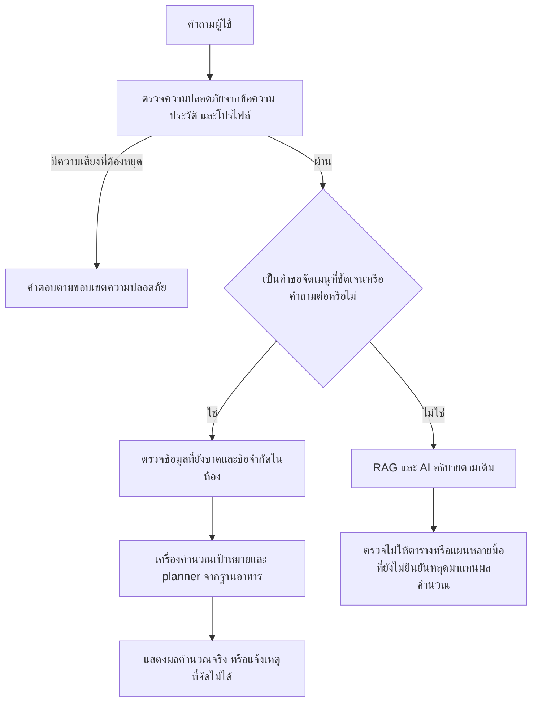

# H2: บังคับเมนูผ่านผลคำนวณที่ตรวจสอบได้ — 18 ตุลาคม 2569

ปัญหาจาก UAT: ผู้ใช้ BMI 15.4 ขอเมนูลดไขมัน ระบบเปลี่ยนเป้าพลังงานเป็น maintain ได้ถูกต้อง แต่โมเดลตอบตารางข้าวขาหมู/เกี๊ยวน้ำ ฯลฯ โดย `tool_calls=[]` แล้วอ้างว่าจัดตามเป้าหมาย จึงตรวจไม่ได้ว่าปริมาณและสารอาหารตรงเป้าจริง

แพตช์นี้ให้ server เรียก planner สำหรับคำขอจัดเมนูที่ชัดเจน แล้ว render อาหาร ปริมาณ และยอดรวมจากผลจริง ไม่ต้องให้โมเดลเลือกว่าจะเรียกเครื่องมือหรือคัดลอกตัวเลขใหม่

## เส้นทางทำงาน

## สิ่งที่เปลี่ยน

- เพิ่ม `menu_request.py` แยกคำสั่งให้จัดเมนูออกจากคำถามเรื่องหลักการ วิธีทำ การค้นค่าของอาหาร และการเปิดเมนู UI ใช้กฎแยกเจตนา ไม่ใช้ประโยค UAT เป็นข้อยกเว้น และไม่เปลี่ยนการคำนวณเป็นคำตอบตายตัว
- รองรับคำถามต่อ เช่น “ขออีกแบบ”, “เพิ่มมื้อเสริมได้”, “ไม่เอามื้อเสริม” เมื่อมีบริบทจัดเมนู การเปลี่ยนไปคุยเรื่องอื่นจะไม่ทำให้คำถามสั้น ๆ ถูกตีเป็นจัดเมนูตลอดไป
- แผนใหม่/ชุดที่ระบุใช้ข้อมูล `suggest_day_menu` ที่สำเร็จหรือได้บางส่วนจากประวัติจริงเป็นตัวกำหนด variant ไม่ใช้ข้อความที่ assistant แต่งว่าเคยจัดชุดใด มีการส่ง metadata ของประวัติที่ไม่ถูกยกเลิกให้ service โดยไม่เปลี่ยน schema
- `sources/tool/delta/done` และ `tool_calls` ยังคงรูปแบบเดิม เก็บประวัติและผลสำเร็จ/บางส่วน/ผิดพลาดได้ เส้นทาง server ใช้ usage 0 และชื่อ route `rule:verified_menu` ใน done event ไม่อ้างว่าเรียกโมเดลแล้ว
- เมนูยังใช้เป้าหมายจาก `calc_nutrition_targets` และรายการอาหาร/ข้อจำกัด/เพดานปริมาณเดิม คำเตือนจากเครื่องคำนวณถูกนำมาแสดงด้วย โดยเฉพาะ BMI ต่ำที่ไม่กำหนดพลังงานขาดดุล ไม่มีการสร้างเลขมาโครจากโมเดล
- ตรวจ safety ก่อนเรียก planner รวมโรค/ประวัติโรค ผู้เยาว์ ตั้งครรภ์ และการขอจำกัดพลังงานรุนแรง ข้อแพ้ที่ไม่รู้จักยังหยุดจัดเมนู
- ข้อมูลที่ขาด เช่น งบที่ยังไม่แจ้ง ยังต้องถามก่อน เมื่อมีจำนวนเงินแล้วจะแจ้งว่ายังไม่ได้คำนวณราคา
- ไม่แสร้งทำแผนหลายวันหรือเฉพาะมื้อเดี่ยว: planner ปัจจุบันจัดเป็นหนึ่งวันรวม 3–6 มื้อ จึงแจ้งขอบเขตและให้ผู้ใช้ระบุคำขอที่รองรับ จำนวน 2/7 มื้อยังแจ้งข้อจำกัดตรงไปตรงมา
- เส้นทางที่โมเดลเลือก tool เองยังใช้ผลคำนวณจริง หากโมเดลส่งตารางอาหารหรืออาหารพร้อมปริมาณในหลายมื้อโดยไม่มีผล planner จะไม่เผยแพร่เป็นผลสำเร็จ รวมกรณี timeout ที่เคยอาจส่งข้อความบางส่วนได้
- ตาราง/ตัวอย่างแบ่งโปรตีนอย่างเดียวและคำถามหลักการทั่วไปยังใช้ AI ได้ ไม่บังคับสร้างรายการอาหารเมื่อผู้ใช้ถามวิธีคิด

ไม่มี migration ไม่เปลี่ยนสูตรพลังงานหรือฐานอาหาร ไม่เปลี่ยน auth และ frontend

## ผลตรวจ

| การตรวจ | ผล |
|---|---|
| กรณีเพิ่มของ H2 | 66 กรณี ครอบคลุมโมเดลไม่เรียก tool, ตารางอาหารที่โมเดลแต่ง, timeout, DB ล้มเหลว, บริบท/variant, ขอบเขตสุขภาพ และการเก็บ SSE ลงประวัติ |
| ชุดที่เกี่ยวข้องด้าน routing / safety / H1 / การแสดงตัวเลข | 278 ผ่าน |
| Backend regression ตามคำสั่ง CI (`not postgres and not evidence`, ยกเว้น source PDF audit) | 1,429 ผ่าน, 70 deselected |
| Ruff สำหรับ app/tests/ingest | ผ่าน |
| Candidate service กับฐานอาหารจริง โดย DB ทุก transaction เป็น read-only | 18 กรณีเมนู/ขอบเขตความปลอดภัย ผ่านโดยไม่เรียก provider หรือ retrieval |
| คำถามหลักการกับ Gemini และ RAG จริง | 2 กรณีผ่าน ยังใช้โมเดลตามเดิม |
| คำนวณย้อนจากปริมาณและค่าต้นทางของฐานอาหาร | 12 แผน รวม 43 มื้อ ตรงภายในระดับการปัดเศษที่แสดง |
| H1 และ regression เดิม | อยู่ในชุด backend และ CI เดิม ไม่ตัดการตรวจ unknown allergy ออก |

หลักฐาน local อยู่ที่ `output/verified-menu-routing-20261018/integration.json`, `independent-audit.json` และ `output/ci-cd/verified-menu-routing/test-results/` ไม่รวมข้อมูลบัญชีหรือ key ในแพตช์นี้

## ขอบเขตและการรับงานบน production

ตัวแยกเจตนายังเป็นกฎทางภาษา และตัวตรวจคำตอบตรวจรูปแบบที่รองรับ ไม่ใช่การพิสูจน์ความหมายของภาษาอิสระทุกประโยค กรณีคำถามที่ไม่เข้ากฎยังอาจใช้โมเดลเลือกเครื่องมือได้ แต่เมนูที่ยืนยันต้องมาจากผลคำนวณ การทบทวนส่วนผสม สารก่อภูมิแพ้ ปริมาณโดยนักกำหนดอาหาร และการตรวจแหล่งอ้างอิงทั่วไปยังเป็นคนละขอบเขต

ก่อนปิด H2 บน production ต้อง deploy commit ที่มีแพตช์นี้แล้วทดสอบผ่านเว็บจริง: กรณี BMI ต่ำจาก UAT 13 ต้องได้เครื่องมือ/ยอดรวม/คำเตือน ไม่เป็นเมนูแต่ง; ตรวจเมนูปกติ คำถามต่อ มื้อเสริม unknown allergy และ medical refusal พร้อมตรวจประวัติหลัง reload และ cleanup บัญชีทดสอบ แพตช์ใน branch หรือผล integration ในเครื่องยังไม่ใช่หลักฐานว่า Railway ใช้รุ่นใหม่แล้ว
